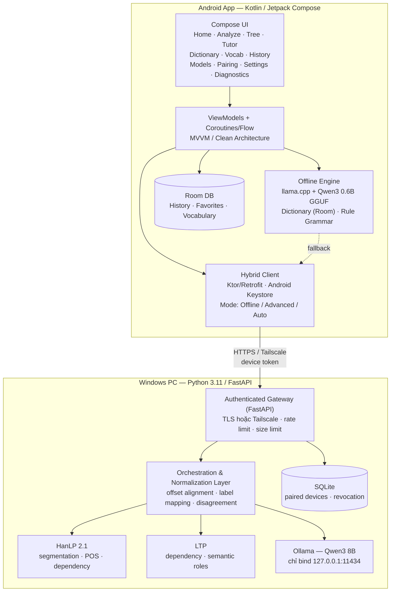
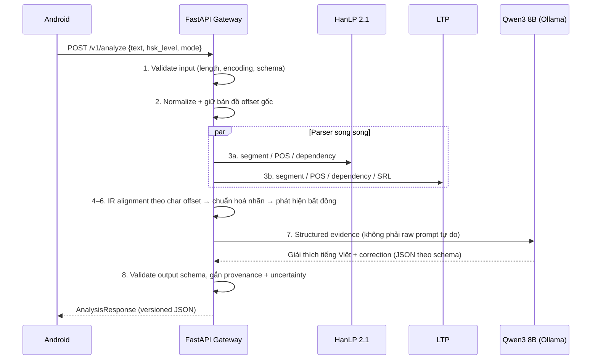
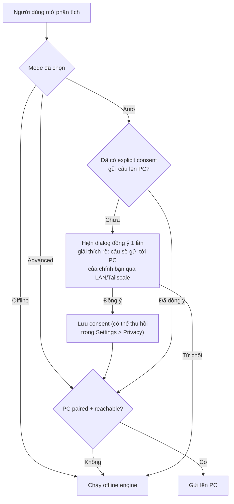

# Kiến trúc hệ thống — Chinese Grammar AI

> Tài liệu kỹ thuật. Thuật ngữ chuyên ngành giữ nguyên tiếng Anh, phần giải thích bằng tiếng Việt.

## 1. Tổng quan hệ thống

Chinese Grammar AI là ứng dụng học & phân tích ngữ pháp tiếng Trung (Mandarin) chạy **hybrid**: điện thoại Android xử lý độc lập khi offline, và nâng cấp lên phân tích sâu khi kết nối được tới PC Windows của chính người dùng.

| Chế độ | Nơi chạy | Engine | Khi nào dùng |
|---|---|---|---|
| **Offline** | Android (on-device) | Qwen3 0.6B GGUF (llama.cpp) + từ điển local + rule-based grammar | Không có mạng, không có PC, hoặc người dùng không đồng ý gửi câu lên PC |
| **Advanced** | Windows PC (LAN / Tailscale) | Qwen3 8B (Ollama) + HanLP 2.1 + LTP | Cần cây cú pháp, đối chiếu 2 parser, giải thích chi tiết tiếng Việt |
| **Hybrid / Auto** | Android quyết định | Offline trước, Advanced khi PC khả dụng | Mặc định sau khi người dùng đã **đồng ý tường minh (explicit consent)** |

Nguyên tắc bất biến:

- **Không bao giờ** gửi câu của người dùng tới nhà cung cấp AI bên ngoài (no external AI providers).
- PC là máy của chính người dùng, đã pairing. Không pairing = không gửi.
- PC không khả dụng → fallback an toàn về Offline, không mất dữ liệu, không treo UI.
- Kết quả do model sinh ra (interpretation) luôn được **phân biệt nhãn nguồn** với kết quả có cấu trúc đã kiểm chứng từ parser (structurally verified).

## 2. Sơ đồ thành phần



## 3. Luồng dữ liệu — NLP Pipeline (Advanced Mode)



Các bước chi tiết:

1. **Validate input** — giới hạn độ dài (`text` tối đa 2000 ký tự, body tối đa 32768 bytes; cấu hình được qua env `MAX_TEXT_CHARS`/`MAX_BODY_BYTES`), kiểm tra encoding UTF-8.
2. **Normalize** — chuẩn hoá khoảng trắng và dấu câu full-width/half-width **nhưng không phá vỡ vị trí ký tự có nghĩa**. Mọi biến đổi đều ghi lại `offset_map` để ánh xạ ngược về chuỗi gốc.
3. **HanLP** — segmentation, POS tagging, dependency parsing.
4. **LTP** — segmentation, POS, dependency parsing, semantic role labeling (bổ sung, không thay thế HanLP).
5. **IR alignment** — chuyển output của cả hai parser về một Intermediate Representation chung, căn chỉnh token bằng **char offset trên chuỗi gốc** (xem mục 4). Không merge mù theo chỉ số token vì hai parser cắt từ khác nhau.
6. **Label normalization** — ánh xạ nhãn qua bảng chuẩn hoá (mục 5). Nhãn không tương đương được giữ nguyên kèm `source`, không ép gộp.
7. **Disagreement detection** — token/ quan hệ nào HanLP và LTP khác nhau → đánh dấu `warnings[]` + tăng `uncertainty`, hiển thị cho người dùng thay vì giấu.
8. **Qwen3 8B explanation** — model chỉ nhận *structured evidence* (tokens, dependencies, disagreements đã chuẩn hoá) và sinh: dịch tiếng Việt, giải thích ngữ pháp theo HSK, correction. Model **không** được bịa quan hệ phụ thuộc mới.
9. **Schema validation** — output validate bằng Pydantic; sai schema → retry có giới hạn hoặc trả partial result kèm warning, không trả JSON tự do.
10. **Provenance + uncertainty** — mọi response mang `provenance{engine, model, parsers}` và `uncertainty` là **một số float 0.0–1.0** (lý do/giải trình nằm ở `warnings[]` dạng chuỗi và `explanation_vi`, không nằm trong `uncertainty`), để Android hiển thị rõ phần nào là parser-verified, phần nào là model-generated.

### Offline pipeline (Android)

Không có HanLP/LTP trên điện thoại. Luồng rút gọn: validate → segment bằng từ điển local (longest-match trên CC-CEDICT subset) → pinyin → rule-based checks (trật tự từ, 的/地/得, lượng từ, cấu trúc 把/被 cơ bản) → Qwen3 0.6B GGUF cho dịch/giải thích đơn giản. **Không bịa dependency tree**: khi offline không có parser thật, UI hiển thị phân tích cấu trúc cơ bản (S/P/O theo rule) và ghi rõ `provenance.engine = "offline-rules"`, cây phụ thuộc đầy đủ chỉ có ở Advanced Mode.

## 4. Unicode Offset Rules — QUAN TRỌNG

Đây là nguồn bug kinh điển khi nối Python ↔ Kotlin, phải tuân thủ tuyệt đối:

| Môi trường | Đơn vị index | Hệ quả |
|---|---|---|
| Python 3 `str` | **Unicode code point** | `"中"[0]`, `len("𐮷") == 1` |
| Kotlin/Java `String` | **UTF-16 code unit** | ký tự ngoài BMP (ví dụ hiếm, emoji) chiếm **2** units (surrogate pair) |
| API JSON của dự án | **Unicode code point offset** (chuẩn duy nhất) | `start` inclusive, `end` exclusive, tính trên chuỗi gốc |

Quy tắc triển khai:

- **Server (Python)** là nguồn sự thật: mọi `start`/`end` trong `tokens[]` là code point offset.
- **Android (Kotlin)** không dùng trực tiếp offset này làm `String.substring(start, end)`. Phải convert:

```kotlin
// Code point offset (từ API) -> UTF-16 index (cho String.substring / Compose AnnotatedString)
fun cpToUtf16(s: String, cpOffset: Int): Int =
    s.offsetByCodePoints(0, cpOffset)   // java.lang.String API

fun utf16ToCp(s: String, utf16Index: Int): Int =
    s.codePointCount(0, utf16Index)
```

- Test bắt buộc: câu chứa ký tự ngoài BMP (ví dụ `𐮷`, emoji trong câu ví dụ) phải round-trip đúng token boundaries ở cả hai phía.
- Không normalize chuỗi (NFC/NFD) sau khi đã tính offset — normalize phải xảy ra ở bước 2 của pipeline, trước khi tính offset, và `offset_map` phải được giữ.
- HanLP/LTP trả offset theo convention riêng của từng thư viện; adapter của từng parser chịu trách nhiệm convert về code point offset trên chuỗi gốc trước khi vào IR. Không giả định hai thư viện dùng cùng convention.

## 5. Bảng chuẩn hoá nhãn — HanLP vs LTP

Hai parser **không** dùng cùng hệ nhãn. Bảng dưới là ánh xạ về nhãn IR chung; ô `—` nghĩa là không có tương đương an toàn, giữ nguyên nhãn gốc kèm `source`.

| Khái niệm IR | HanLP 2.1 | LTP | Ghi chú |
|---|---|---|---|
| Chủ ngữ `nsubj` | `SBV` (主谓) | `SBV` | Khớp |
| Tân ngữ `dobj` | `VOB` (动宾) | `VOB` | Khớp |
| Động từ hạt nhân `root` | `HED` | `HED` | Khớp |
| Định ngữ `att` | `ATT` | `ATT` | Khớp |
| Trạng ngữ `advmod` | `ADV` | `ADV` | Khớp |
| Bổ ngữ `comp` | `CMP` | `CMP` | Khớp tương đối; kiểm tra hướng arc |
| Giới tân / đối tượng giới từ `pobj` | `POB` | `POB` | Khớp |
| Liên kết phối hợp `conj` | `COO` | `COO` | Khớp |
| Semantic role (A0/A1) | — | `A0`/`A1` (SRL) | Chỉ LTP có; IR giữ ở trường riêng `semantic_role`, không trộn vào dependency label |
| POS: danh từ | `NN` | `n` | Hệ POS khác hẳn nhau — map qua bảng POS riêng, không so sánh trực tiếp chuỗi nhãn |
| POS: động từ | `VV` | `v` | Như trên |
| POS: tính từ | `JJ`/`VA` | `a` | Như trên |
| POS: phó từ | `AD` | `d` | Như trên |

Nguyên tắc: so sánh disagreement chỉ thực hiện **sau** chuẩn hoá, trên các token đã align theo offset. Token mà hai parser cắt khác nhau (ví dụ một bên cắt `研究生命`, một bên cắt `研究生` + `命`) → ghi nhận là *segmentation disagreement*, không cố ép align 1-1.

## 6. Lưu trữ (Storage)

| Nơi | Dữ liệu | Công nghệ / bảo vệ |
|---|---|---|
| Android | History, favorites, saved vocabulary | Room (SQLite), nằm trong app sandbox |
| Android | Device token pairing với PC | Android Keystore-backed (EncryptedSharedPreferences / Keystore) — không lưu plaintext |
| Android | Offline model GGUF | App-specific storage, verify SHA-256 trước khi load |
| Android | Export/import | File JSON do người dùng chủ động xuất; validate schema khi import |
| Windows | Paired devices, revocation list | SQLite (`server/data/devices.db`), không chứa nội dung câu của người dùng |
| Windows | Nội dung câu phân tích | **Không persist mặc định** — xử lý in-memory, log đã redact (xem THREAT_MODEL.md) |

## 7. Chọn chế độ & luồng đồng ý AUTO (Mode Selection + Consent)



Quy tắc:

- Consent hỏi **một lần duy nhất** trước lần Auto đầu tiên gửi câu đi; không hỏi lại mỗi câu, nhưng người dùng thu hồi bất cứ lúc nào trong Settings → Privacy, thu hồi là có hiệu lực ngay.
- Consent **không** mặc định bật. Cài mới → mode mặc định là Offline.
- Advanced chọn tay từng lần thì không cần consent lưu trữ, nhưng lần đầu vẫn hiện xác nhận gửi câu lên PC.
- Mọi lần fallback về Offline do PC mất kết nối đều hiện trạng thái rõ ràng (không im lặng giả vờ đã phân tích nâng cao).
